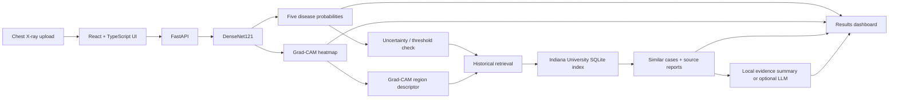

# RadSync
## Explainable Chest X-ray Analysis and Historical Context Retrieval

RadSync is a research prototype that combines multi-label chest X-ray classification, Grad-CAM visual explanations, and retrieval of similar historical chest X-ray studies with their radiology reports.

> **Research-use notice:** RadSync is not a medical device and must not be used to diagnose, rule out disease, or guide treatment. Model scores, heatmaps, retrieved reports, and generated summaries are experimental outputs that require qualified clinical interpretation.

## What it does

1. **Classifies an X-ray** with a DenseNet121 model and returns probability scores for five thoracic findings:
   - Atelectasis
   - Effusion
   - Infiltration
   - Mass
   - Nodule
2. **Explains a selected class prediction** with Grad-CAM heatmaps generated from the DenseNet121 feature extractor.
3. **Retrieves historical reference cases** from a local Indiana University / Open-i SQLite index when a model score lies near its validation-selected threshold.
4. **Displays source reports and contextual summaries.** A local evidence summary works without an LLM; optional Google Gemini summarization can be configured separately.

## Architecture



## Technology stack

| Layer | Technologies |
|---|---|
| Frontend | React, TypeScript, Vite, TanStack Router |
| Backend | Python, FastAPI, Uvicorn |
| Classification | PyTorch, Torchvision, DenseNet121 |
| Explainability | Grad-CAM |
| Retrieval | NumPy feature vectors, SQLite |
| Summarization | Local evidence summary; optional Gemini API |
| Development | Bun, Git, GitHub, VS Code |

## Model evaluation

The classifier is a five-label (multi-label) model. The following figures are from the held-out test predictions saved by the model evaluation pipeline. The binary classification thresholds were selected on the validation split and then applied to the test split.

| Metric | Test result |
|---|---:|
| Macro ROC-AUC | **0.8094** |
| Macro F1-score | **0.4256** |
| Mean per-class accuracy (macro one-vs-rest accuracy) | **85.3360%** |
| Exact-match / subset accuracy | **49.8782%** |

Per-class one-vs-rest accuracy:

| Disease | Accuracy |
|---|---:|
| Atelectasis | 84.5345% |
| Effusion | 87.0223% |
| Infiltration | 71.5055% |
| Mass | 91.4593% |
| Nodule | 92.1582% |

**How to interpret these metrics:** Per-class accuracy includes true negatives and can be high when negative labels are common. Exact-match accuracy is stricter: all five labels must be correct for an image to count as correct. Macro F1 is the arithmetic mean of the five class-level F1-scores and is important for interpreting positive-class detection. ROC-AUC measures ranking/discrimination across thresholds. Do not present 85.3360% as an unqualified single-label classification accuracy.

These figures describe the classifier on its evaluated dataset only. They do not validate Grad-CAM localization, historical retrieval quality, or clinical performance.

## Datasets and their roles

- **NIH ChestX-ray14:** Used to train/evaluate the DenseNet121 classifier. The original image archive is not distributed with this repository. Saved prediction arrays and validation thresholds are sufficient to reproduce the reported metric calculations without re-running image inference.
- **Indiana University / Open-i chest X-ray collection:** Used as a separate historical reference collection. Frontal studies and linked radiology reports are indexed locally for retrieval. The IU reports are not ground-truth labels for the NIH-trained classifier.

Follow the license and terms that accompanied the exact dataset copies used. Do not redistribute source datasets or derived indexes unless their terms permit it.

## Run locally (Windows CMD)

### 1. Backend

From the repository root:

```cmd
venv\Scripts\activate.bat
pip install -r Server\requirements.txt
python -m uvicorn Server.main:app --host 127.0.0.1 --port 8000
```

The checkpoint is expected at `models/densenet121_best.pth`. The API loads the checkpoint on startup and selects CUDA when available; CPU inference is also supported.

Check the service at:

- `http://127.0.0.1:8000/health`
- `http://127.0.0.1:8000/docs`

### 2. Frontend

Open a second CMD window:

```cmd
cd Client
bun install
bun run dev
```

Open the local URL printed by Vite (normally `http://localhost:5173`). The frontend uses `VITE_API_BASE_URL` when configured; otherwise it calls `http://127.0.0.1:8000`.

### 3. Historical retrieval index

The historical index is generated locally and is not stored in Git. The IU index builder defaults to the paths described in [Server/README.md](Server/README.md). Build the index after placing the IU CSV files and frontal image files in the expected local folders:

```cmd
python -m ml.build_iu_index --limit 50
```

Verify the inserted records, then continue indexing. The builder is resumable and skips already indexed case IDs:

```cmd
python -m ml.build_iu_index --limit 3818
```

Start the backend with the desired index path configured when using a non-default location:

```cmd
set RADSYN_IU_INDEX=data/iu_index.sqlite
python -m uvicorn Server.main:app --host 127.0.0.1 --port 8000
```

See [Server/README.md](Server/README.md) for the full index schema, environment variables, retrieval evaluation, and optional LLM configuration.

## Reproduce evaluation metrics without the NIH image archive

When `ml/evaluation/test_predictions.npz` and `ml/evaluation/thresholds.csv` are present, the metric script does not load images or the model checkpoint. Install its small evaluation dependencies and run:

```cmd
pip install -r ml\requirements-evaluation.txt
python -m ml.evaluate_saved_predictions
```

It reports per-class accuracy, precision, recall/sensitivity, specificity, F1, and ROC-AUC, as well as macro metrics, micro F1, and exact-match accuracy. It writes JSON and CSV reports to `ml/evaluation/`.

The full image-based evaluator, `python ml\evaluate_model.py`, requires the original NIH image archive and should only be run when that archive is available.

## API endpoints

| Method | Endpoint | Purpose |
|---|---|---|
| GET | `/health` | API/model/index status |
| POST | `/predict` | Five class probabilities |
| POST | `/gradcam` | Grad-CAM heatmap for one class |
| POST | `/retrieve` | Uncertainty-triggered historical retrieval |
| POST | `/summarize` | Context-only report summary |

## Important limitations

- The model was trained on NIH ChestX-ray14 and the historical retrieval collection is IU/Open-i; dataset shift may affect predictions.
- Grad-CAM is a visualization of model sensitivity, not a lesion segmentation, proof of causality, or validated localization metric.
- Retrieval currently combines normalized model score vectors (65%) with a coarse Grad-CAM region descriptor (35%). The weights are experimental and have not been established as optimal.
- The IU retrieval evaluation uses report-derived weak labels, not expert-adjudicated relevance judgments. It is leave-one-case-out within one collection, not external or patient-level validation.
- The local evidence summary is deterministic; optional LLM output is constrained to supplied reports and model scores but can still be imperfect.
- No component has been clinically validated. RadSync is intended for academic demonstration and research exploration only.

## Repository guide

- `Client/` — React application
- `Server/` — FastAPI API and inference/retrieval services
- `ml/` — index builders and evaluation scripts
- `models/` — DenseNet121 checkpoints
- `data/splits/` — model split metadata
- `Server/README.md` — detailed backend, dataset, and retrieval setup
